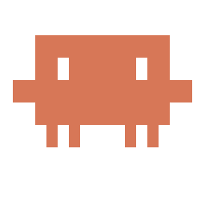
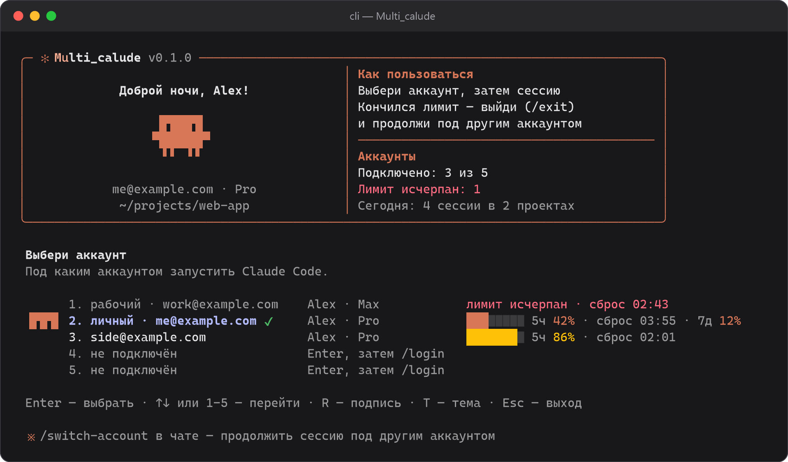
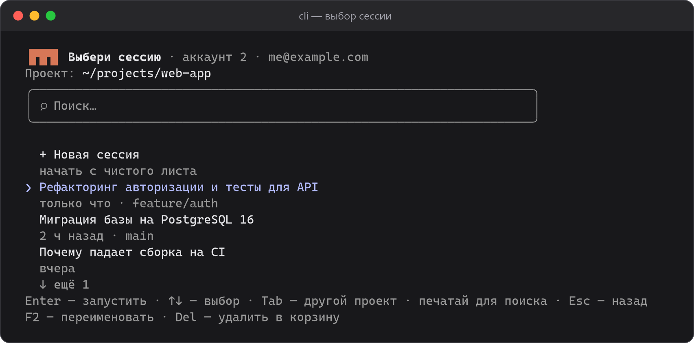
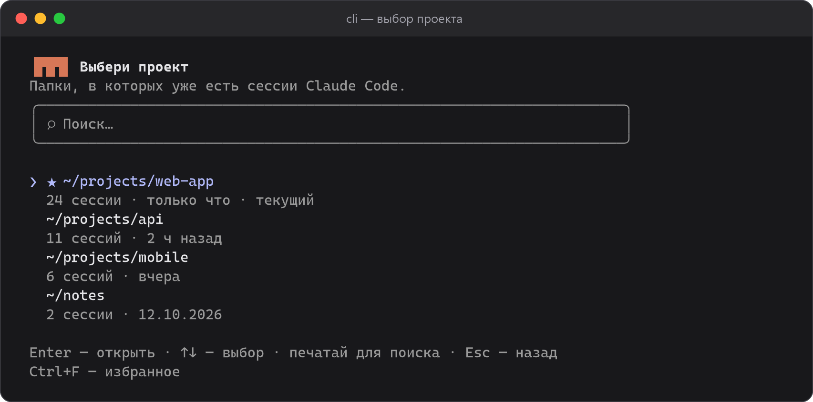
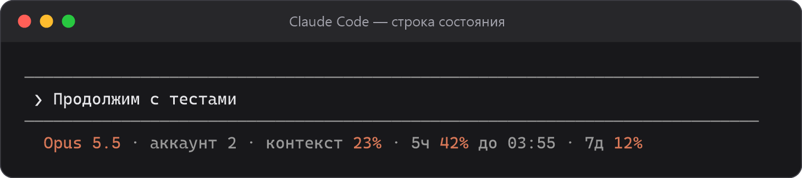
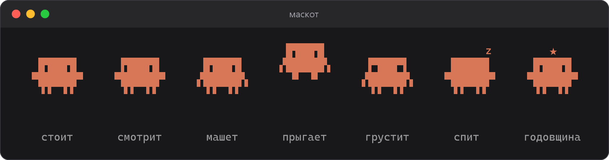
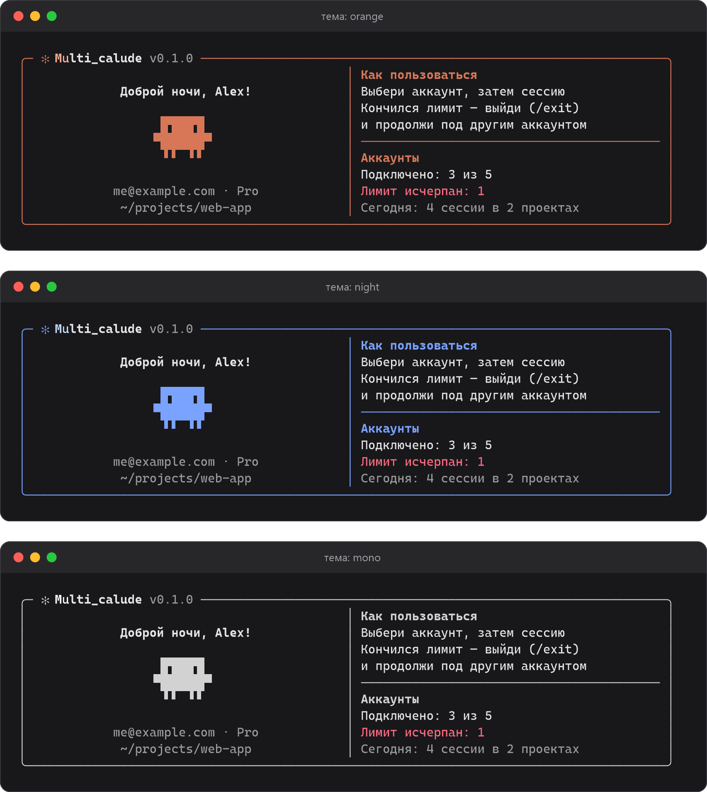

<div align="center">



# Multi_calude

**Несколько аккаунтов Claude Code в одном терминале.**<br>
Выбирай аккаунт и сессию в меню в стиле Claude Code, продолжай разговор под другим аккаунтом, когда кончился лимит, и держи лимиты всех аккаунтов на виду.

[](https://github.com/Ivantech123/Multi_calude/releases/latest)
[](https://github.com/Ivantech123/Multi_calude/actions)

[](LICENSE)

[Установка](#установка) · [Возможности](#возможности) · [Управление](#управление) · [Как это устроено](#как-это-устроено) · [English](#english)

<br>



</div>

<br>

## Возможности

<table>
<tr>
<td width="50%" valign="top">

### 🔀 До пяти аккаунтов

У каждого аккаунта свой вход, а всё остальное общее: история сессий и память, скиллы, агенты, команды, плагины, настройки и MCP-серверы.

</td>
<td width="50%" valign="top">

### ↪️ Разговор не теряется

Кончился лимит — набери в чате `/switch-account`, выбери другой аккаунт, и та же сессия продолжится с того же места.

</td>
</tr>
<tr>
<td valign="top">

### 📊 Лимиты на виду

5-часовой и недельный лимит каждого аккаунта с временем сброса — в меню и в строке состояния. Курсор сам встаёт на аккаунт с наибольшим запасом.

</td>
<td valign="top">

### 🗂️ Сессии и проекты

Поиск по сессиям, переименование, корзина, избранные проекты, переход в другой проект прямо из чата через `/switch-project`.

</td>
</tr>
<tr>
<td valign="top">

### 🔔 Значок в трее (Windows)

Лимиты всех аккаунтов при наведении и уведомление, когда исчерпанный лимит сбросился. Клик по аккаунту — сразу запуск под ним.

</td>
<td valign="top">

### ✻ С душой

Анимированный маскот, три темы, подписи аккаунтов, приветствие по времени суток, снег зимой и шапка на Новый год.

</td>
</tr>
</table>

Аккаунты переключаются только вручную: программа не меняет аккаунт сама, когда кончается лимит.

## Скриншоты

<div align="center">

 

<sub>Выбор сессии с поиском и выбор проекта с избранным</sub>

<br><br>



<sub>Строка состояния внутри Claude Code: модель, аккаунт, контекст и оба лимита</sub>

<br><br>



<sub>Маскот живёт своей жизнью: оглядывается, машет, прыгает, грустит при исчерпанном лимите и засыпает, если меню оставить</sub>

<br><br>

<details>
<summary><b>Темы оформления</b> — оранжевая, ночная, монохром (клавиша <code>T</code>)</summary>
<br>

</details>

</div>

## Установка

Нужен установленный [Claude Code](https://claude.com/claude-code).

**Windows** — установщик [`multi_calude-setup-x64.exe`](https://github.com/Ivantech123/Multi_calude/releases/latest) или одна команда в PowerShell:

```powershell
irm https://raw.githubusercontent.com/Ivantech123/Multi_calude/main/install.ps1 | iex
```

**macOS и Linux:**

```sh
curl -fsSL https://raw.githubusercontent.com/Ivantech123/Multi_calude/main/install.sh | sh
```

Установщик добавляет команду `cli` в PATH и выполняет `cli --install`: включает строку состояния с лимитами и добавляет команды `/switch-account` и `/switch-project`. Если строка состояния уже настроена другой программой, она не трогается.

| Платформа | Файл |
|---|---|
| Windows x64 | `multi_calude-setup-x64.exe` или `multi_calude-win-x64.zip` |
| Windows ARM | `multi_calude-win-arm64.zip` |
| macOS Apple Silicon / Intel | `multi_calude-osx-arm64.tar.gz` / `multi_calude-osx-x64.tar.gz` |
| Linux x64 / ARM | `multi_calude-linux-x64.tar.gz` / `multi_calude-linux-arm64.tar.gz` |

Ручная установка: скачай архив из [релизов](https://github.com/Ivantech123/Multi_calude/releases/latest), распакуй и запусти `cli --install`.

## Управление

```
cli            меню: аккаунт → сессия
cli 2          сразу аккаунт 2, без меню
cli 2 -c       продолжить последнюю сессию в этой папке под аккаунтом 2
cli --about    версия
```

Любые другие параметры передаются в Claude Code как есть. Чтобы подключить аккаунт, выбери пустую строку в меню и выполни в Claude `/login`.

| Клавиша | Где | Что делает |
|---|---|---|
| `↑` `↓` `1`–`5` `Enter` | аккаунты | выбор |
| `R` | аккаунты | подпись аккаунта, например «рабочий» |
| `T` | аккаунты | тема |
| `Пробел` | аккаунты | маскот танцует |
| `Tab` | сессии | список проектов |
| печать | сессии, проекты | поиск |
| `F2` / `Del` | сессии | переименовать / убрать в корзину |
| `Ctrl+F` | проекты | в избранное |
| `Esc` | везде | назад; в меню аккаунтов — выход |

В чате Claude Code: `/switch-account` — продолжить сессию под другим аккаунтом, `/switch-project` — перейти в другой проект. Обе команды работают в сессиях, запущенных через `cli`.

## Как это устроено

- Аккаунт 1 — обычный `~/.claude`. Аккаунты 2–5 живут в `~/.claude-acc2` … `~/.claude-acc5` (через `CLAUDE_CONFIG_DIR`).
- Папки `projects`, `skills`, `agents`, `commands`, `plugins` у аккаунтов 2–5 — ссылки на папки аккаунта 1 (junction на Windows, symlink на macOS и Linux). Настройки и MCP-серверы первого аккаунта передаются через `--settings` и `--mcp-config`.
- Лимиты приходят из данных, которые Claude Code передаёт строке состояния (`cli --statusline`), и сохраняются для каждого аккаунта отдельно. Появляются после первого ответа в сессии, на тарифах Pro и Max.
- Подписи, избранное, названия сессий и тема хранятся в `~/.claude-accounts.json`, удалённые сессии — в `~/.claude-accounts-trash`.

> [!NOTE]
> Не открывай одну и ту же сессию одновременно под двумя аккаунтами: они будут писать в один файл.

## Удаление

- **Windows:** «Параметры → Приложения» → Multi_calude, или
  ```powershell
  & ([scriptblock]::Create((irm https://raw.githubusercontent.com/Ivantech123/Multi_calude/main/install.ps1))) -Uninstall
  ```
- **macOS и Linux:**
  ```sh
  curl -fsSL https://raw.githubusercontent.com/Ivantech123/Multi_calude/main/install.sh | sh -s -- --uninstall
  ```

Аккаунты и сессии при удалении не трогаются.

## Сборка из исходников

Нужен .NET 8 SDK.

```sh
scripts/build.sh          # macOS / Linux → dist/multi_calude-<платформа>.tar.gz
scripts\build.ps1         # Windows → dist\multi_calude-win-x64.zip
scripts\screenshots.ps1   # картинки для README из настоящего кода меню
```

Релиз для всех платформ собирает GitHub Actions по тегу: `git tag v0.1.1 && git push --tags`.

## English

**Multi_calude** runs Claude Code with up to five of your own accounts. It gives you a Claude Code–style picker for the account and the session, shares history, memory, skills and settings between accounts, shows each account's rate limits in the menu and the status line, lets you continue the same conversation under another account with `/switch-account`, and on Windows adds a tray icon that tells you when a limit resets. Install with the commands above. The interface is in Russian.

---

<sub>Неофициальный проект, не связан с Anthropic. Claude и Claude Code — товарные знаки Anthropic. Используй только свои аккаунты и соблюдай <a href="https://www.anthropic.com/legal/consumer-terms">условия использования</a>. Лицензия <a href="LICENSE">MIT</a>.</sub>
